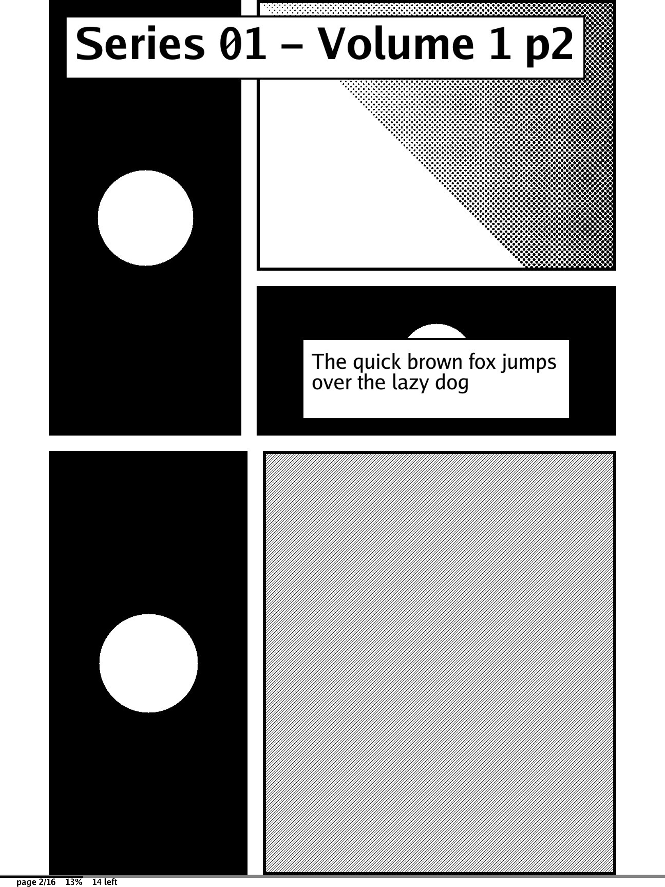
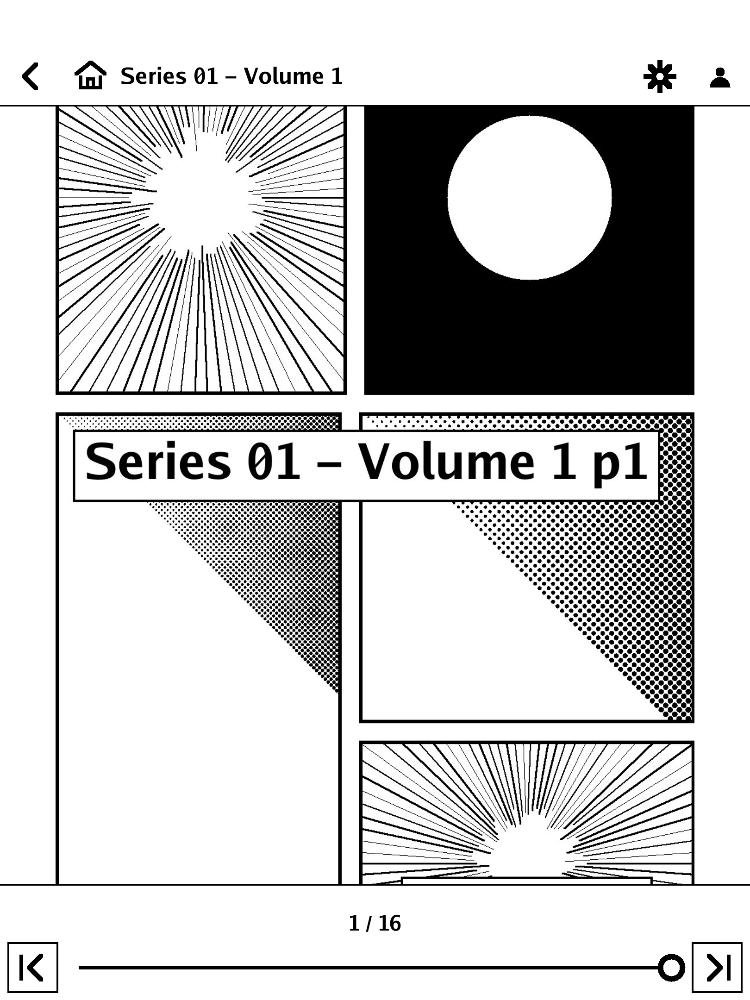
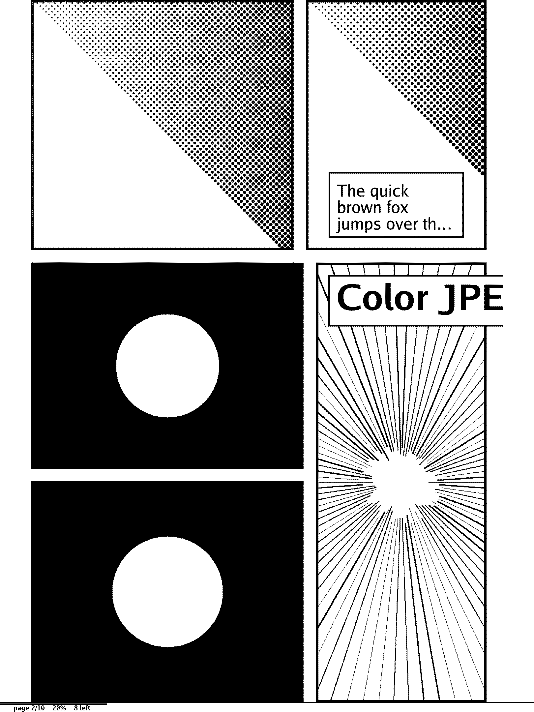
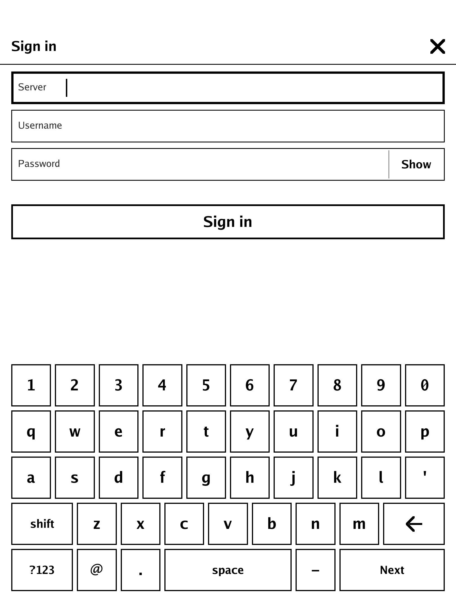
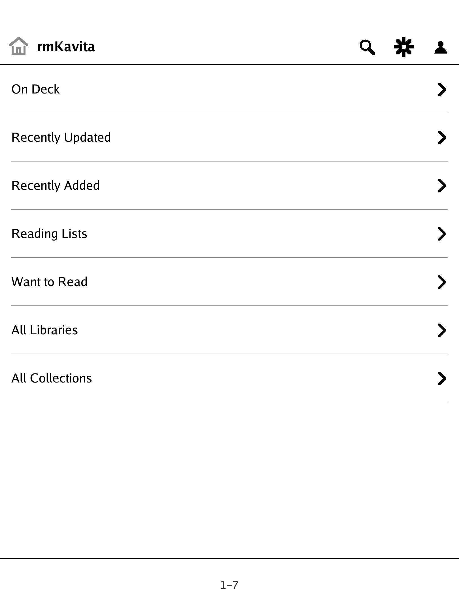
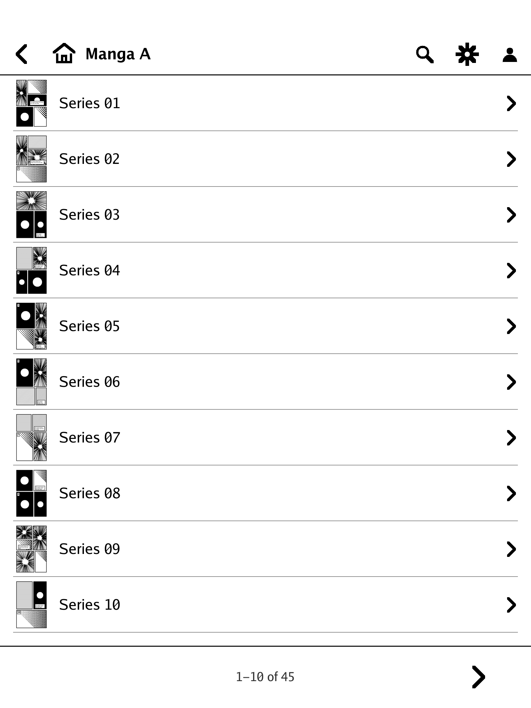
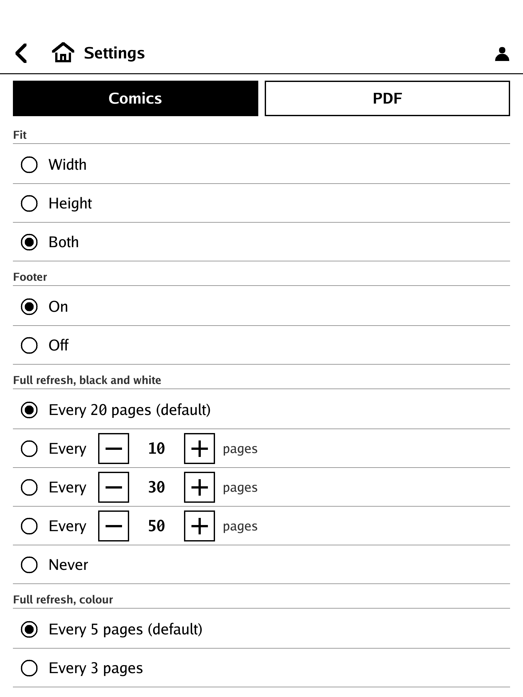
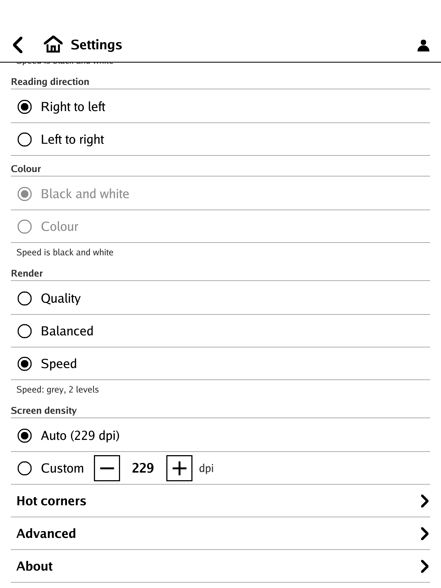
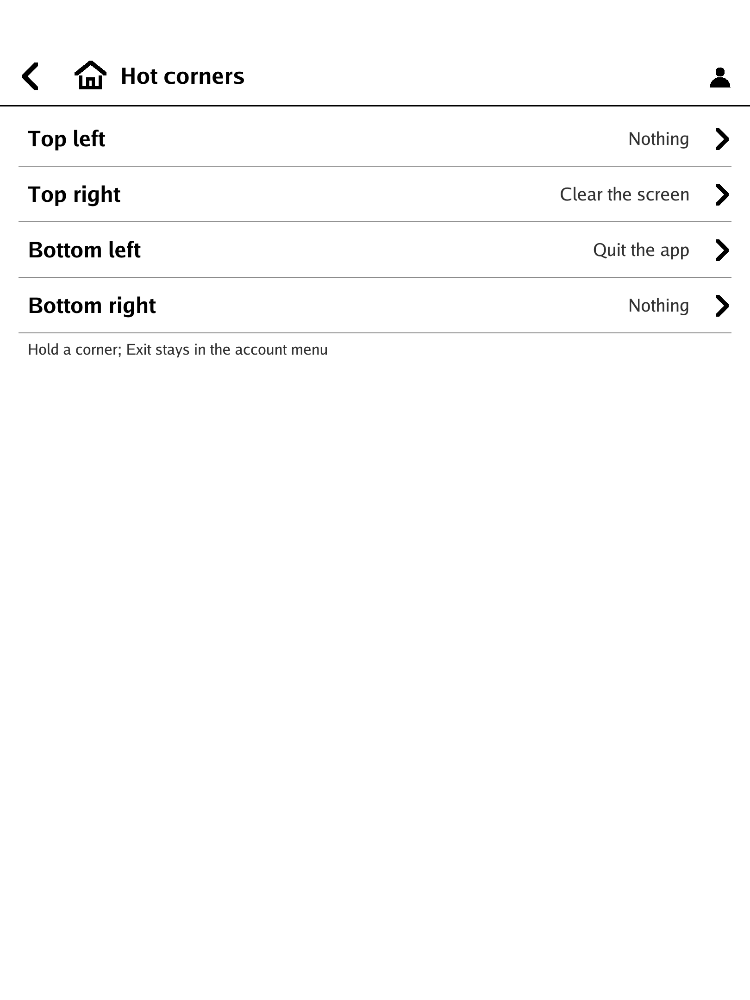

# rmKavita

A small Kavita reader for the reMarkable Paper Pro. It streams comics, manga and PDFs from your
[Kavita](https://www.kavitareader.com) server page by page and draws them straight onto the e-ink panel through
AppLoad's framebuffer. Nothing is downloaded; nothing is kept on the tablet except a configuration file and your
reading positions.

> **Unofficial.** rmKavita is not affiliated with, endorsed by or sponsored by Kavita, reMarkable, KOReader or any
> other project it works with or learned from. Names are used only to say what the program works with. See
> [CREDITS.md](CREDITS.md).

<p>



</p>

All screenshots are rendered from synthetic test fixtures with the program's PNG test backend (no real library
content, no account); the pages are generated line art.

## What it does

- Signs in with your Kavita user name and password. The password is never stored; the app keeps the server address,
  your user name and the OPDS key Kavita returns, in a file only the tablet's `root` can read.
- Browses your libraries and series over OPDS, shows covers, searches.
- Reads comics (CBZ / CBR / image folders) and PDFs that Kavita serves as page images: page by page, fit width /
  height / both (a page taller than the screen scrolls inside itself first), left-to-right or right-to-left,
  optional colour.
- Remembers where you stopped and reports it back to Kavita.
- Turns a page with one partial update. A clearing refresh comes every N pages (20 for black and white pages, 5 for
  colour pages) and waits until you have paused for a moment.
- Margin trim, a page-border colour that matches the page, a footer (page n/N, percent, pages left, progress line).
- Hot corners: hold a screen corner to quit, clear the screen, go home, jump to the first / last page, next /
  previous chapter, toggle direction, fit or footer.
- A **Speed** render mode for fast page turns: pages are shown in grey, reduced to two grey levels ahead of time.
  Speed is black and white: the colour choice is greyed out and left alone, and comes back when you leave Speed.
- Keeps a few pages ahead (3) and behind (2) in memory, bounded by a byte budget, and watches the system's free
  memory so it can never starve the tablet's own app.
- No accounts, no cloud, no telemetry.

## What it is not

- Not a downloader and not an offline library: it needs the server while you read.
- Not an EPUB or text-book reader (entries without a page-image stream are not listed).
- Not a Kavita replacement: it does not edit your library, collections or metadata.
- No continuous / scrolling-strip mode: e-ink is not built for it.
- No annotations yet (the hook for them exists; see the roadmap).

## Requirements

- reMarkable Paper Pro with **xovi and AppLoad 0.5.0 or newer**
  (0.5.0 added the RGBA8888 framebuffer type the app asks for first; without it the app falls back to RGB565).
  The Paper Pro Move is handled by the same code and uses its own panel size and density, but has not been tested.
- A Kavita server with OPDS enabled for your user (tested against Kavita 0.9.1.4).
- SSH key access to the tablet, from a computer with a POSIX shell (Linux, macOS, Git Bash, WSL), to install.

## Install

Download the release tarball (`rmkavita-0.3.0-linux-arm64.tar.gz` with `SHA256SUMS`) or build it yourself
(see below), then:

```sh
sha256sum -c SHA256SUMS                   # optional: check the download
tar xzf rmkavita-0.3.0-linux-arm64.tar.gz
cd rmkavita-0.3.0
cp install/install.conf.sample install/install.conf   # TABLET_HOST, SSH_KEY, PACKAGE_DIR, the Kavita address
./install/install.sh --dry-run            # read-only checks and the plan; changes nothing
./install/install.sh
```

Then **tap AppLoad's reload button on the tablet before you open the app**: a launcher icon cached from a
previous copy of the app can crash the UI when the app was replaced underneath it. Then start **rmKavita**.
Details, the optional Tailscale "door" and the uninstall are in
[`install/README-install.md`](install/README-install.md).

### Uninstall

```sh
./install/install.sh --uninstall           # app folder, config, settings, door units, staging
./install/install.sh --uninstall --purge   # ... and your reading positions
```

AppLoad drops the entry at its next reload.

## First launch

1. The Sign-in screen asks for the server address, user name and password. Use the on-screen keyboard.
2. The home screen is the starting point: what you were reading, your libraries, search. Open a series and a chapter.
3. While reading, controls are hidden. The screen is three columns: the left and the right column turn the page
   (right-to-left comics: the left column goes forward), the middle column (40 % wide by default) opens and closes
   the top and bottom bars, as does a downward swipe from just below the top edge. The bottom bar has first-page
   and last-page buttons at the ends of the slider; a thin footer under the page shows page n/N, percent and pages
   left. Hold a corner for about a second: top-right clears the screen, bottom-left quits.
4. Settings is the gear in the top bar, left of the person icon (the person icon holds Logout and Exit).

<p>



</p>

## Settings tour

<p>



</p>

- **Fit**: width, height or both (per document kind: Comics, PDF).
- **Footer**: on or off.
- **Full refresh**: every N pages for black and white pages and for colour pages (default 20 and 5), or never.
- **Reading direction**: right to left (manga) or left to right.
- **Colour**: black and white (default) or colour. Colour is slower and ghosts more.
- **Render**: *Quality* (every grey, the slowest waveform), *Balanced* (the default), *Speed* (grey, two grey
  levels, pages prepared ahead; the colour rows are greyed out while it is on).
- **Screen density**: auto from the device, or a custom dpi.
- **Hot corners**: what holding each corner does.
- **Advanced**: the display A/B kit (waveform per activity, clearing refresh style and timing, bars repaint,
  framebuffer format, page border, margins, speed levels and dither) and the memory budget. The same keys are
  documented in [`package/rmkavita.conf.sample`](package/rmkavita.conf.sample).
- **About**: the version, the licence, where the credits are.

## Configuration

`/home/root/.config/rmkavita.conf` (mode 600) and `rmkavita-settings.json` next to it. Every key and its values
are documented in [`package/rmkavita.conf.sample`](package/rmkavita.conf.sample). Log: `/tmp/rmkavita.log`
(rotates at 384 KB; one line per screen update with the waveform used, the latencies and the count of seconds
the panel server slept; never a URL, key or password).

## Troubleshooting

- **The tablet is unreachable while installing.** The tablet sleeps with its Wi-Fi: wake it, check `TABLET_HOST`
  and `SSH_KEY`. `ssh -i KEY root@HOST true` must work without a prompt.
- **The door is down / the server cannot be reached.** If your Kavita server is only reachable through Tailscale,
  the optional "door" (`DOOR=yes`) forwards a local port to it. Check that the tablet is on the tailnet and that
  the door socket is active (`systemctl status rmkavita-door.socket`); otherwise point the app at a server address
  the tablet can reach directly.
- **"Not signed in" / the key was refused.** The OPDS key was rotated or the account changed. Sign in again from
  the account menu or the Sign-in screen; the key is replaced in the config file.
- **The UI crashes right after replacing the app.** Tap AppLoad's reload button before opening the new copy.
- **Greys look tinted.** Settings -> Advanced -> Framebuffer -> RGB565 (or `fb_format = rgb565`), then relaunch.
- **Page turns flash or ghost.** Advanced -> Page turns: UI is the default; try Fast or Content. Clearing
  refresh: Content + full refresh clears harder (and costs two more one-second waits).
- **Page turns are too slow.** Settings -> Render -> Speed (Advanced -> Speed levels 2 / 4 / 16, Speed dither).
  `go run ./cmd/mkcbz -speed <folder>` writes a grey and a colour six-page chapter to compare the modes.
- **A tap near the very top opens AppLoad's own menu.** The strip above 100 px belongs to AppLoad; the app's reveal
  swipe starts at 120 px. The middle column opens the bars at any height.
- **It stopped answering touches.** It should not (a resting thumb or palm, or a lost release, cannot block it); if
  it does, the log has `input:` lines and counters on every update line.
- **`rmkavita -selftest`** on the tablet prints the catalogue walk and per-page fetch / decode / fit timings
  (p50 / p95) and memory; it never prints the key or the password.

## Build and test

Go as named in `go.mod`; no cgo, no other tools.

```sh
go vet ./... && go test ./...
GOOS=linux GOARCH=arm64 go vet ./...
./build.sh        # package/rmkavita, static, stripped, reproducible (-trimpath, no VCS stamp)
./release.sh      # build twice, check the hashes match, write dist/SHA256SUMS and the tarball
```

`go test` needs no tablet and no Kavita: a mock Kavita (`internal/mockkavita`) serves synthetic comics, PDFs and
OPDS feeds, and the tests drive the real app on a fake display and a fake AppLoad peer.
`go run ./cmd/mkcbz -ab "AB Test.cbz"` writes a 12-page chapter with screentone, a black page, small text, grey and
colour ramps for judging the display settings on your own panel. How it works is in
[`docs/DESIGN.md`](docs/DESIGN.md); what is planned is in [`ROADMAP.md`](ROADMAP.md); changes are in
[`CHANGELOG.md`](CHANGELOG.md); how to contribute and how to report a security problem are in
[`CONTRIBUTING.md`](CONTRIBUTING.md) and [`SECURITY.md`](SECURITY.md).

## Licence

rmKavita is **source-available**, not "open source" in the OSI sense. It is licensed under the
**[PolyForm Noncommercial License 1.0.0](LICENSE)**:

- You may use it, read it, change it and share it for any **personal or other noncommercial** purpose, free of
  charge.
- **Commercial use requires a separate licence** from the author; ask through the repository.
- The text in [`LICENSE`](LICENSE) is the only authority; this summary is not part of it.
- Third-party components keep their own licences, listed in [`NOTICE`](NOTICE); who and what this project learned
  from is in [`CREDITS.md`](CREDITS.md).

The name "rmKavita" and the icon belong to the author and are not licensed for use as the name of another product.

Required Notice: Copyright (c) 2026 testyfishy (https://github.com/testyfishy/rmKavita)
