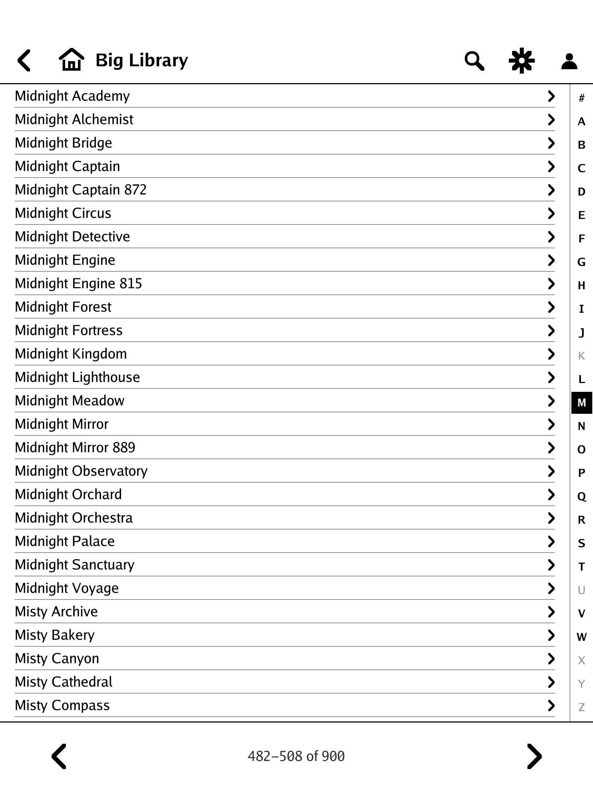

# rmKavita

**Read the comics and manga on your [Kavita](https://www.kavitareader.com) server on a reMarkable Paper Pro.**
rmKavita streams pages straight from the server onto the e-ink panel, one page at a time. Nothing is downloaded and
nothing is kept on the tablet except a small configuration file and your reading positions.

> **Unofficial.** rmKavita is not affiliated with, endorsed by or sponsored by Kavita, reMarkable, KOReader or any
> other project it works with or learned from. See [CREDITS.md](CREDITS.md).

<p>



</p>

*The screenshots are rendered from synthetic test pages: no real library content, no account.*

## What it does

- **Streams, never stores.** Pages are fetched over Kavita's OPDS page-streaming interface, kept in a small memory
  window around the page you are on, and dropped. A few pages are read ahead so turns are quick.
- **Built for big libraries.** A list of more than 40 entries is shown in compact rows, with an **A-Z bar** on the
  right edge that jumps to a letter (tested with a library of 900 series).
- **Made for e-ink.** One partial update per page turn, a clearing refresh every N pages that waits until you pause,
  true greys, optional colour, and a **Speed** mode that shows grey pages prepared ahead of time for the fastest turns.
- **Made for comics and manga.** Right-to-left or left-to-right, fit width / height / both, margin trim, a page
  border that matches the page, a footer with page, percent and pages left, three tap columns and hot corners.
- **Remembers where you stopped**, and reports it back to Kavita.
- **Private.** No accounts, no cloud, no telemetry. The password is typed on the tablet and never stored.

Not goals: downloads or offline reading, EPUB and other text books (entries without page images are not listed),
editing your library, a scrolling-strip mode. See the [roadmap](ROADMAP.md).

## Requirements

- A **reMarkable Paper Pro** with [xovi and AppLoad](https://github.com/asivery/rm-appload) **0.5.0 or newer**.
  Tested on a Paper Pro (software 3.28) with AppLoad 0.6.0. The Paper Pro Move uses the same code with its own panel
  size and density, but has not been tested.
- A **Kavita** server the tablet can reach, with OPDS enabled for your user (tested with Kavita 0.9.1.4).
- SSH key access to the tablet, from a computer with a POSIX shell (Linux, macOS, Git Bash, WSL), to install.

## Install

Download the tarball and `SHA256SUMS` from the [latest release](https://github.com/testyfishy/rmKavita/releases/latest),
or [build it yourself](CONTRIBUTING.md#build-and-test), then:

```sh
sha256sum -c SHA256SUMS --ignore-missing   # optional: check the download
tar xzf rmkavita-0.3.1-linux-arm64.tar.gz
cd rmkavita-0.3.1/install
cp install.conf.sample install.conf        # set TABLET_HOST, SSH_KEY and the Kavita address
./install.sh --dry-run                     # read-only checks and the plan; changes nothing
./install.sh
```

Then **tap AppLoad's reload button on the tablet before you open the app** (a launcher icon cached from an earlier
copy can crash the UI), and start **rmKavita**. The details, the optional Tailscale "door" and the uninstall are in
the [install guide](install/README-install.md).

## Using it

Sign in with your Kavita user name and password, open a series, and tap the right or left column of the screen to
turn pages; tap the middle to open the bars. Hold a corner for about a second to clear the screen (top right) or quit
(bottom left). Everything else is in the **[user guide](docs/USER-GUIDE.md)**: browsing, the A-Z bar, every setting,
and troubleshooting.

## Documentation

| | |
|---|---|
| [User guide](docs/USER-GUIDE.md) | signing in, reading, hot corners, settings, files, troubleshooting |
| [Install guide](install/README-install.md) | the installer, the optional Tailscale door, uninstall |
| [Design](docs/DESIGN.md) | how it works: display path, page pipeline, long lists, input, memory |
| [Configuration reference](package/rmkavita.conf.sample) | every key of the config file |
| [Changelog](CHANGELOG.md) · [Roadmap](ROADMAP.md) | what changed, what is planned and why |
| [Contributing](CONTRIBUTING.md) · [Security](SECURITY.md) | build and test, contribution terms, reporting a problem |

## Credits and inspiration

rmKavita would not exist without **[Kavita](https://github.com/Kareadita/Kavita)** and its OPDS page streaming
([OPDS-PSE](https://github.com/anansi-project/opds-pse)); **[AppLoad, xovi and qtfb](https://github.com/asivery/rm-appload)**
by asivery, which let an app draw on the Paper Pro; and the Go project's [image libraries and fonts](NOTICE), which
are compiled into the program. It learned how e-ink readers behave from
**[KOReader](https://github.com/koreader/koreader)** and **[Plato](https://github.com/baskerville/plato)**, and how
manga readers should treat a page from **[Mihon](https://github.com/mihonapp/mihon)**, **[KCC](https://github.com/ciromattia/kcc)**,
**[screentone](https://github.com/ophymx/screentone)** and **[Komga](https://github.com/gotson/komga)**. No code was
copied from any of them. Every project, its licence and what it taught is listed in **[CREDITS.md](CREDITS.md)**.

rmKavita was written with **[Claude](https://claude.com/claude-code)** (Claude Code, by Anthropic), directed and tested on a
real tablet by its author.

## Licence

rmKavita is **source-available**, not "open source" in the OSI sense. It is licensed under the
**[PolyForm Noncommercial License 1.0.0](LICENSE)**:

- You may use it, read it, change it and share it for any **personal or other noncommercial** purpose, free of
  charge.
- **Commercial use requires a separate licence** from the author; ask through this repository.
- The text in [`LICENSE`](LICENSE) is the only authority; this summary is not part of it.
- Third-party components keep their own licences, listed in [`NOTICE`](NOTICE).

The name "rmKavita" and the icon belong to the author and are not licensed for use as the name of another product.

Required Notice: Copyright (c) 2026 testyfishy (https://github.com/testyfishy/rmKavita)
