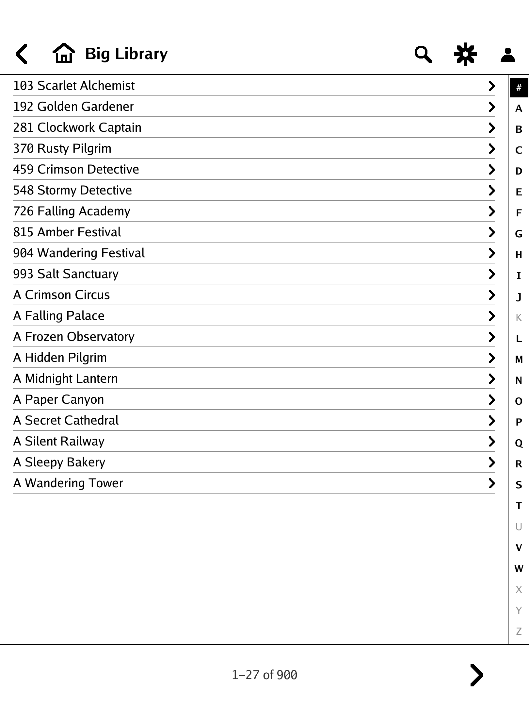
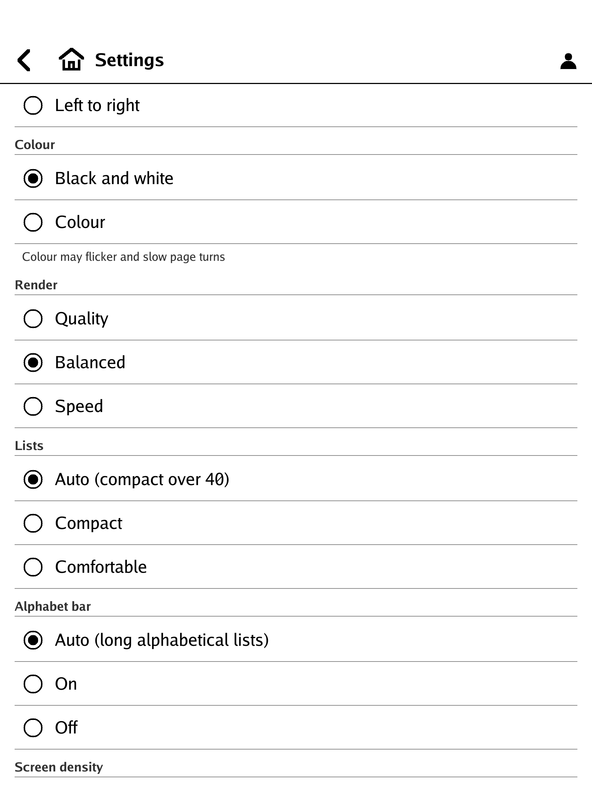

# rmKavita user guide

How to use rmKavita once it is installed (see [the install guide](../install/README-install.md)). Everything here is
done on the tablet.

Contents: [Sign in](#sign-in) · [Browsing](#browsing) · [Long libraries](#long-libraries) · [Reading](#reading) ·
[Hot corners](#hot-corners) · [Settings](#settings) · [Files and configuration](#files-and-configuration) ·
[Troubleshooting](#troubleshooting)

## Sign in

The first launch shows the Sign-in screen: the server address, your Kavita user name and password, typed on the
on-screen keyboard. The app trades them for your account's OPDS key and stores the server address, the user name and
that key in a file only the tablet's `root` can read. **The password is never stored.** To sign out, use the account
menu (the person icon in the top bar): *Logout* removes the key, *Exit* closes the app.

## Browsing

Home lists what you were reading (On Deck), recently updated and added series, reading lists, Want to Read, your
libraries and collections. The top bar has Back and Home on the left; Search, Settings (the gear) and the account
menu on the right. Series and chapters without a page-image stream (for example EPUB books) are not listed: rmKavita
reads images.

## Long libraries

A list of more than 40 entries is shown in compact one-line rows, about 27 to a screen, and an **A-Z bar** runs
down the right edge.

- **Tap a letter** to put the first entry that starts with it on top. `#` is for digits, symbols and non-Latin
  scripts. Letters with no entries are dim.
- **Drag along the bar** to outline a letter; the list jumps when you lift your finger.
- The whole list loads in the background (the footer says "Loading list 3/45"); you can use it straight away and
  more letters come alive as it fills.
- Back from a series returns you to the same place. Opening the same library again in the same session is instant;
  rmKavita checks the first page for changes and reloads if there are any.
- The bar needs an alphabetical list. It is not offered for "Recently Added" or for a series' volumes, where it
  would lie; *Settings -> Alphabet bar -> On* shows it anywhere.

## Reading

While reading, controls are hidden. The screen is **three columns**:

- the **left and right columns turn the page** (for right-to-left comics, the left column goes forward);
- the **middle column** (40 % wide by default) opens and closes the top and bottom bars. So does a downward swipe
  that starts just below the top edge.

The bottom bar has a page slider with first-page and last-page buttons at its ends. A thin **footer** under the page
shows page n/N, the percentage and the pages left. The page border takes the colour of the page's own edge and empty
margins are trimmed (at most 10 % per side); both can be turned off.

A page turn is one partial update. Every N pages (20 for black and white pages, 5 for colour) the screen is cleared;
the clear waits until you have paused for a moment so it never interrupts a quick run of pages. Where you stopped is
remembered and reported back to Kavita.

## Hot corners

Hold a corner of the screen for about a second:

| Corner | Default | Other choices |
|---|---|---|
| top right | clear the screen | none, quit, home, settings, controls, first page, last page, next chapter, previous chapter, colour, direction, fit, footer |
| bottom left | quit | (the same list) |
| top left, bottom right | none | (the same list) |

*Settings -> Hot corners* changes them.

## Settings

The gear in the top bar.

- **Fit**: width, height or both, separately for comics and PDF. A page taller than the screen scrolls inside itself
  first, then turns.
- **Footer**: on or off.
- **Full refresh**: every N pages for black and white pages and for colour pages (default 20 and 5), or never.
- **Reading direction**: right to left (manga) or left to right.
- **Colour**: black and white (default) or colour. Colour is slower and ghosts more.
- **Render**: *Quality* (every grey, the slowest waveform), *Balanced* (the default) or *Speed* (grey, two grey
  levels, pages prepared ahead of time). Speed is black and white: the colour rows are greyed out while it is on and
  your colour choice comes back when you leave it.
- **Lists**: *Auto* (compact when a list has more than 40 entries), *Compact* or *Comfortable* (rows with covers).
- **Alphabet bar**: *Auto*, *On* or *Off*.
- **Screen density**: automatic from the device, or a custom dpi.
- **Hot corners**: what holding each corner does.
- **Advanced**: the display A/B kit (waveform per activity, how the screen is cleared and when, bar repainting,
  framebuffer format, page border, margins, speed levels and dither) and the memory budget.
- **About**: the version, the licence and where the credits are.

## Files and configuration

| File | What it is |
|---|---|
| `/home/root/xovi/exthome/appload/rmkavita/` | the app (binary, manifest, icon) |
| `/home/root/.config/rmkavita.conf` (mode 600) | server, user name, OPDS key, and the advanced keys |
| `/home/root/.config/rmkavita-settings.json` | what Settings changes |
| `/home/root/.config/rmkavita-state.json` | where you stopped in each chapter |
| `/tmp/rmkavita.log` | the log; rotates at 384 KB |

Every key of the configuration file is documented in [`package/rmkavita.conf.sample`](../package/rmkavita.conf.sample).
The log has one line per screen update (waveform, rectangle, latencies, the seconds the panel server slept); it never
contains a URL, key or password. Nothing else is written to the tablet: pages exist only in memory.

## Troubleshooting

- **The UI crashes right after replacing the app.** Tap AppLoad's reload button before opening the new copy; a launcher
  icon cached from the old copy can crash the UI.
- **"Not signed in" or the key was refused.** The OPDS key was regenerated or the account changed. Sign in again from
  the account menu; the key in the config file is replaced.
- **The server cannot be reached.** The tablet must be able to reach the server address you gave. If your Kavita is
  only reachable through Tailscale, the installer's optional "door" forwards a local port to it (see
  [`install/README-install.md`](../install/README-install.md)); check that the door's socket is active with
  `systemctl status rmkavita-door.socket`.
- **Greys look tinted.** *Settings -> Advanced -> Framebuffer -> RGB565* (or `fb_format = rgb565`), then relaunch.
- **The A-Z bar is missing.** See [Long libraries](#long-libraries): Auto only shows it on alphabetical lists of
  more than 40 entries.
- **Page turns flash or ghost.** *Advanced -> Page turns*: UI is the default; try Fast or Content. For the clearing
  refresh, *Content + full refresh* clears harder and costs two more one-second waits.
- **Page turns are too slow.** *Settings -> Render -> Speed*, and *Advanced -> Speed levels* (2, 4 or 16) and
  *Speed dither*. `go run ./cmd/mkcbz -speed <folder>` writes a grey and a colour six-page chapter to compare the
  modes on your own panel; `-ab` writes a twelve-page chapter for judging the display settings.
- **A tap near the very top opens AppLoad's own menu.** The strip above 100 px belongs to AppLoad; the app's reveal
  swipe starts at 120 px. The middle column opens the bars at any height.
- **It stopped answering touches.** It should not: a resting thumb or palm, or a lost release, cannot block it. If
  it happens, the log has `input:` lines and counters on every update line; please open an issue with them.
- **Self-test.** `rmkavita -selftest` on the tablet prints the catalogue walk, per-page fetch, decode and fit timings
  (p50 / p95) and memory. It never prints the key or the password.

If something is not listed here, [open an issue](https://github.com/testyfishy/rmKavita/issues) with the version
(*Settings -> About*), your tablet's software version, AppLoad's version and the last lines of the log, with any
server address or key removed.
